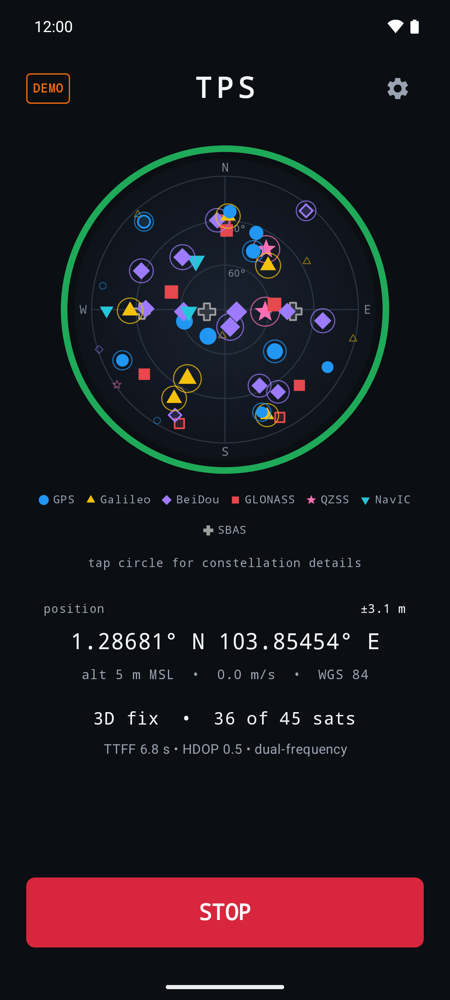
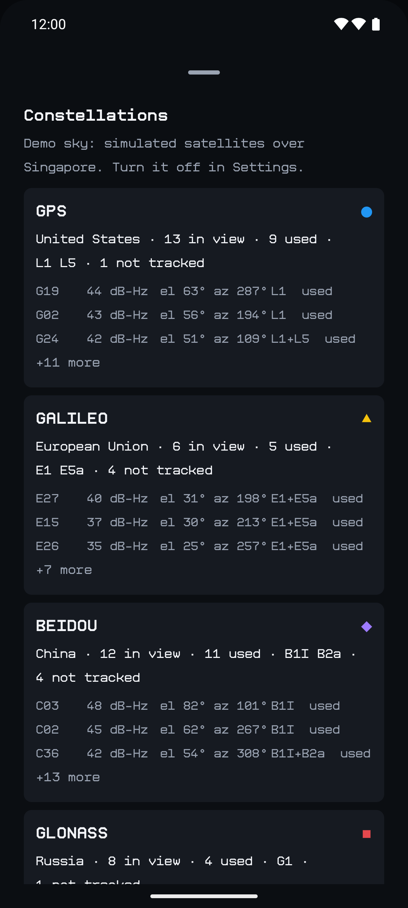
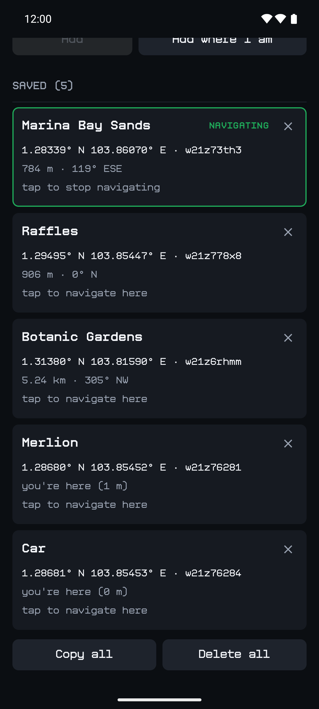

# TPS: Terran Positioning System

*Every nation's satellites, one position.*

An open-source Android app that shows where you are and which satellites told it.
A modern phone already fuses the American, Russian, European, Chinese, Japanese and
Indian navigation systems into a single fix. TPS makes that visible: a sky circle with
every satellite your phone can hear, each system in its own colour and shape, and your
position, fix quality and the time from the satellites below it. It can also navigate
you to a list of waypoints.

TPS has **no network permission**, no Google Play services and no background location.
It reads the phone's GNSS chip directly, and nothing leaves the phone.

## Screenshots

<p align="center">
  
  &nbsp;&nbsp;
  
  &nbsp;&nbsp;
  
</p>

<p align="center"><sub>Demo sky (simulated satellites over Singapore, where all seven systems are overhead) on an Android 16 emulator.</sub></p>

## What it shows

- **The sky circle.** Up is where the phone points, the edge is the horizon and the centre
  is overhead.
  Every satellite the chip reports is drawn where it is:
  - **colour and shape** per system: GPS blue circle, Galileo gold triangle, BeiDou violet
    diamond, GLONASS red square, QZSS pink star, NavIC cyan inverted triangle, SBAS grey
    cross. The shapes are on by default because GPS blue and BeiDou violet look the same
    with red-green colour blindness.
  - **filled** = used in the fix, **hollow** = received but not used, **faint** = predicted
    from the almanac but not received
  - **size** = signal strength (C/N0); a **thin ring** = received on two frequencies
- **The ring** around it is fix quality: red and pulsing while searching, orange for a 2D
  fix or accuracy worse than 15 m, yellow for 15 m or better, green for 5 m or better.
- **Position**: coordinates (decimal or degrees-minutes-seconds) and a **geohash**, each
  tap to copy, with height above sea level and speed.
- **Fix line**: 2D or 3D, satellites used out of those in view, time to first fix, HDOP,
  and whether the fix uses two frequencies.
- **Satellite time**: the time from GNSS, in your time zone and in UTC, and how far off
  the phone's own clock is.
- **Waypoints** (the star): paste a list, one per line, a label and a position in either
  order: `Trailhead, 44.46044, -110.82814`, `Car 9xchyjc2v` or
  `44°27'37.6"N 110°49'41.3"W Camp`. Or save where you are and name it. Tap one to
  navigate: a triangle outside the ring points to it, with the distance and bearing below
  the circle.
- **The circle turns with the phone** (heading-up), so the triangle points the way to
  walk. Turn **Turn with the phone** off in Settings for north-up.
- **Own fixes** (in progress, v0.3): on phones that hand apps raw measurements, TPS
  computes its own position, once per system and once for all, plotted around the chip's
  fix. A different answer from the chip, or from another system, is a cross-check
  against spoofing. TPS gets the orbits by decoding the satellites' navigation messages
  itself (GPS and Galileo so far). On phones that don't pass those on, it uses the
  satellite positions the chip computes: Android makes the getter system-only, but every
  measurement carries the data in its public serialized form, and TPS reads it from there.
- **CHIP card**: the GNSS hardware, what it can do (raw measurements, navigation
  messages, satellite positions, carrier phase…), the signals it supports, and a
  **raw-data recorder** that writes Google's GnssLogger format (plus the chip's satellite
  positions) and shares the file.
- **Constellations sheet** (tap the circle): all seven systems, each with who runs it,
  satellites in view and used, its bands, and a row per satellite. A POSITION card has
  the rest: both coordinate formats, geohash, ellipsoid and sea-level height,
  accuracies, DOP, GNSS time against the phone clock, and the fix's age.

## How it works

- TPS starts listening as soon as it's on screen and stops when it leaves. It asks
  `LocationManager` for `GPS_PROVIDER` fixes directly. The fused provider would hide which
  satellites made a fix, and Android only runs the GNSS engine while someone holds such a
  request.
- **The phone's GNSS chip computes the fix**, combining every constellation it receives.
  Android doesn't let apps choose which. TPS shows which satellites the chip used.
- Satellites come from `GnssStatus`. A dual-frequency satellite arrives once per band,
  and TPS merges the entries. Band names come from the carrier frequency, as each system
  names it (L5 is E5a on Galileo and B2a on BeiDou).
- DOP and 2D/3D come from the chip's NMEA `GSA` sentence. Phones that don't send one get
  DOP computed from the geometry of the satellites in the fix, and an inferred 2D/3D,
  labelled as such. Time to first fix comes from the chip, or from TPS's own clock if
  GNSS was already running when TPS started.
- Satellite time is the UTC each fix carries, carried forward between fixes by the
  phone's monotonic clock. TPS shows it but can't set the phone's clock.
- Height above sea level comes from Android (API 34+), Android's bundled geoid model, or
  the geoid separation in the chip's NMEA `GGA` sentence, in that order.
- Heading-up uses the rotation-vector sensor, corrected to true north with Android's
  built-in World Magnetic Model (offline). It only runs in that mode, on screen.

The design and the research behind it are in [PLAN.md](PLAN.md).

## Install

Android 8.0 or newer. Releases are on
[GitHub Releases](https://github.com/KaraZajac/TPS/releases) as a debug-signed APK to
sideload. Every push also builds one (Actions, then the run, then `tps-apk`).

Allow **precise** location when asked. With approximate location Android sends no
satellite data at all.

## Build

```sh
./gradlew :app:assembleDebug        # app/build/outputs/apk/debug/app-debug.apk
./gradlew :app:testDebugUnitTest    # GNSS model, NMEA, DOP, geohash, waypoints, compass math, formats
```

JDK 17 or newer and the Android SDK (compileSdk 37). The emulator's GNSS invents a few
GPS satellites with no position, so turn on **Settings → Demo sky** to see a full sky
there.

## Privacy

TPS requests location and nothing else. CI checks every APK against that allowlist
([`scripts/check-permissions.sh`](scripts/check-permissions.sh)) and fails the build if a
dependency adds a network permission. Waypoints and settings stay on the phone.

## License

BSD-3-Clause; see [LICENSE](LICENSE). The typeface is
[Kibernetyk Mono](https://pavlokilko.github.io/KibernetykMono/) by Pavlo Kilko, under the
SIL Open Font License 1.1 (`app/src/main/assets/licenses/KibernetykMono-OFL.txt`). The
icons are from Material Icons (Apache License 2.0).
